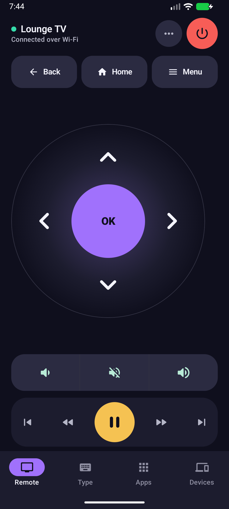
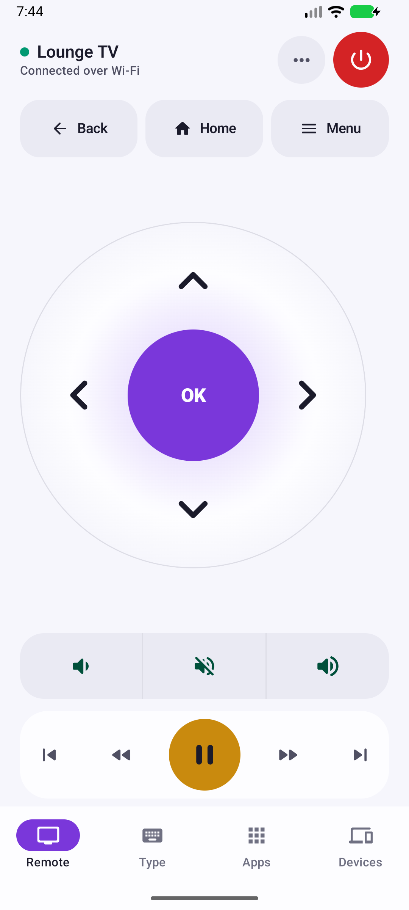
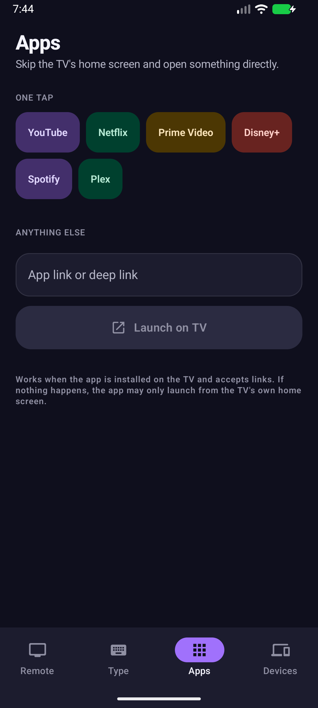

# Xiaomi TV Remote

An Android phone remote for Xiaomi / Android TV devices on the same local network.

## Current status

A native Kotlin + Jetpack Compose Android app with a working Android TV Remote Protocol v2 client: LAN discovery (NSD), the mTLS pairing handshake with on-TV code entry, and persisted per-device client credentials. Once paired, the app sends real key events, volume/media commands, text input (IME batch edit), and app deep links over the protocol, it isn't a UI mockup.

A GitHub Actions pipeline builds a debug APK on every push.

## Screens

Four destinations along the bottom, each doing one job:

- **Remote**: the whole remote on one screen, no scrolling. Status and power up top, a large D-pad dial, a segmented volume rocker, and the transport deck within thumb reach.
- **Type**: a big message field plus Clear, Delete and Enter keys, for search boxes, logins and browsers on the TV.
- **Apps**: one-tap deep links for the usual streaming apps, and a field for any link the TV can resolve.
- **Devices**: the paired TV, Wi-Fi discovery, and manual IP entry for when discovery is blocked.

Extra keys (Menu, Search, Settings, Sleep, Wake) live in a sheet opened from the Remote screen, so they never take space away from the D-pad.

| Light mode | Apps |
| --- | --- |
|  |  |

## Design notes

The palette is authored in OKLCH and mapped to Compose tokens in `Theme.kt`. Neutrals carry a little violet chroma instead of going grey, and every accent ships as a solid fill, the text that sits on it, and a tonal container with its own text colour, so a colour is never reused for a job it cannot do.

- Dark is the default (a remote gets used with the lights down), with a real light palette following the system setting.
- Contrast is measured, not eyeballed: body text 17.4:1 and secondary text 9.5:1 on the dark background, 15.8:1 and 7.3:1 on the light one, all above WCAG AA.
- Every key is at least 48dp, primary keys are 56dp or larger, and D-pad arrows, volume, Delete and Enter repeat while held.
- Presses shrink the key and fire a haptic tick, so a tap is felt as well as seen.
- Icon-only keys carry content descriptions for TalkBack.

## Download the APK

1. Open the repository's **Actions** tab.
2. Open the latest successful **Build Android APK** workflow run.
3. Under **Artifacts**, download `xiaomi-tv-remote-debug`.
4. Extract the ZIP and install `app-debug.apk` on your Android phone.

Android may ask you to allow installation from your browser/file manager.

## Build

The CI build uses Java 17, Gradle 8.9, Android Gradle Plugin 8.7.3, Kotlin 2.0.21, and `:app:assembleDebug`.

## Roadmap

Shipped: LAN discovery, pairing-code flow, persistent per-device credentials, D-pad/power/home/back, volume and media transport keys, text input, app-launch links, and the mobile-first UI rework (bottom-tab navigation, OKLCH colour system, light and dark themes, hold-to-repeat keys).

Remaining:

- Touchpad mode (swipe-to-D-pad gesture translation; the protocol has no continuous pointer message, so this emulates a trackpad via accelerated key repeats, it isn't literal cursor injection)
- ViewModel-based state management and unit tests for the protocol framing
- Multi-device favorites
